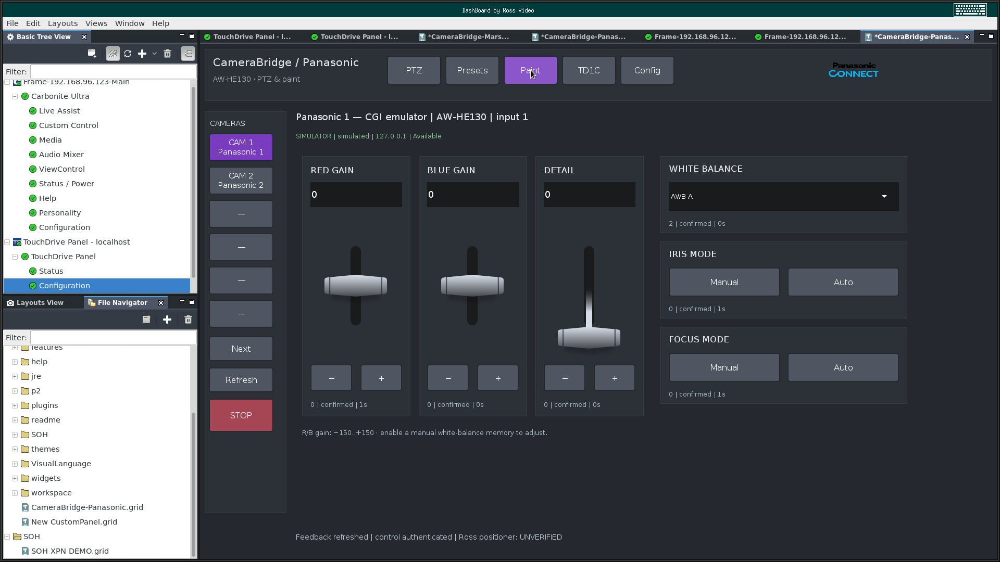
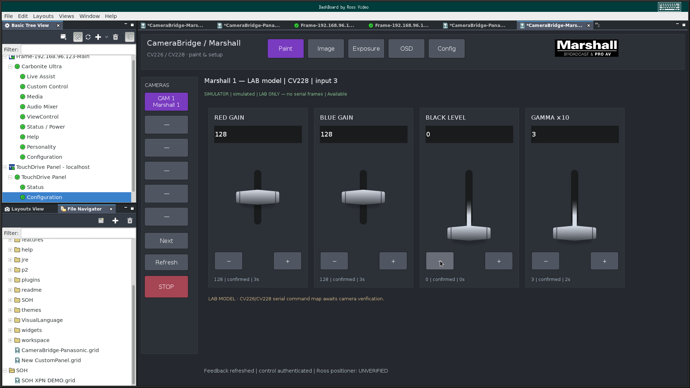

# Touch layout tests

The panels were developed on Windows.
Native TouchDrive DashBoard screens were checked over VNC at 1920 × 1080.
The 1366 × 800 canvas leaves room for the existing tree, menu and tabs.
The tests did not change the screen resolution or DashBoard theme.

| Control | Size or arrangement |
|---|---|
| Native fader | Widget 26; broad handle, approximately 120 × 40 screen pixels |
| Page navigation | 104 × 56 pixels |
| Command button or field | At least 48 pixels high |
| Left rail STOP | 124 × 64 pixels |
| Panasonic direction pad | Eight direction buttons and a central STOP |
| Panasonic shots | Twenty buttons on one page |
| Marshall Paint and Image | Four faders per page |
| Open CameraBridge | 180 × 56 pixels in each header |

Native login and feedback worked on both panels.
A Panasonic iris fader change reached 2834 with confirmed emulator feedback.
The value field then restored 1365 with confirmed feedback.
Marshall black level changed from 0 to 1 and back to 0 with confirmed lab feedback.
Touch jogging remained disabled after the tests.
No physical camera was used for these interface tests.

The new Open CameraBridge button has separate release tests.
Earlier screen captures below show the large touch layout before that button was added.

Geometry tests check canvas bounds and minimum control size.
Script tests check native bindings and live feedback in a JavaScript test context.
These checks do not establish physical camera behavior.
